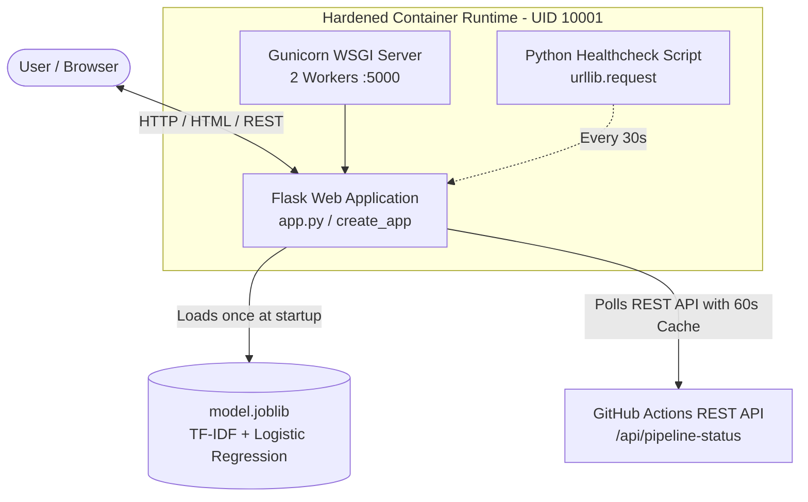
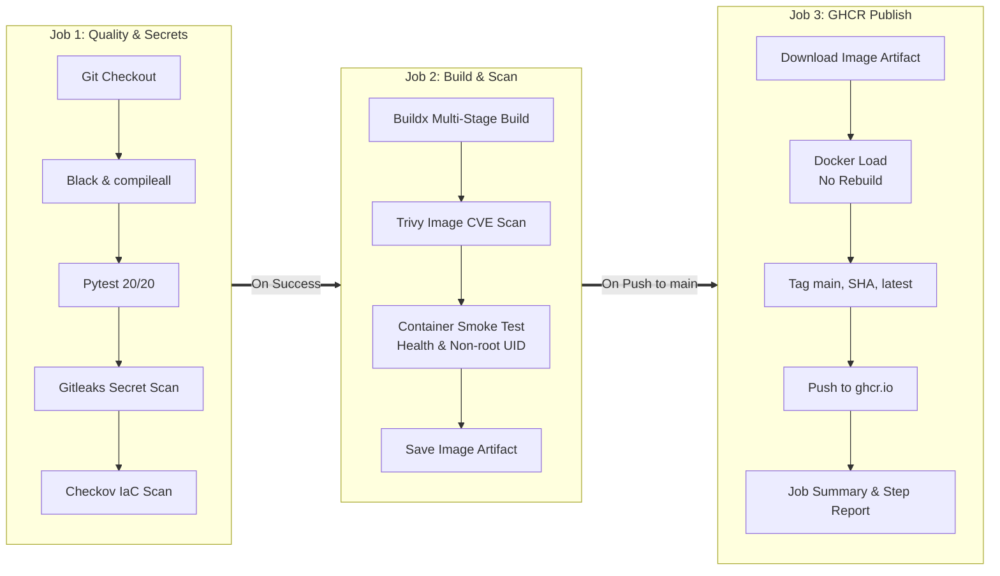

# SecureDeploy ML &mdash; Automated DevSecOps Pipeline & Sentiment Classifier

> **Cloud Computing Lab Mini-Project (Course Code: DJS23ALMD701)**  
> **Target Platform:** Windows 10/11 (PowerShell & Docker Desktop) &bull; Linux / macOS Compatible  
> **Domain:** Applied Machine Learning, Containerization, DevSecOps Security Automation, and Cloud CI/CD

---

## 1. Project Overview & Problem Statement

Modern machine learning deployments frequently suffer from the "works on my machine" syndrome and dangerous security oversights: credentials leaked into Git histories, vulnerable container base layers with unpatched CVEs, runtime execution as `root`, and fragile deployment pipelines that rebuild images after testing instead of promoting verified artifacts.

**SecureDeploy ML** bridges the gap between AI development and production-grade Cloud Security Engineering. It features:
1. An NLP-based **Financial News Sentiment Classifier** using deterministic TF-IDF feature extraction and Multinomial Logistic Regression.
2. A hardened, production-ready **multi-stage Docker container** running as an unprivileged non-root user (UID 10001) with internal Python health checking.
3. Automated **DevSecOps security gates** using **Gitleaks** (secret scanning), **Checkov** (Infrastructure as Code security), and **Trivy** (container vulnerability and misconfiguration scanning).
4. A 3-stage **GitHub Actions CI/CD pipeline** that packages, scans, verifies, and promotes immutable container images directly to **GitHub Container Registry (GHCR)**.
5. An interactive, responsive, accessible **blue-and-white dashboard** providing real-time sentiment predictions, in-memory session history, and live tracking of GitHub Actions pipeline health.

> [!NOTE]
> **Academic Demonstration Disclaimer:**  
> The included headline dataset (`data/headlines.csv`, 180 rows) is a demonstration dataset created specifically for Cloud Computing Lab learning and educational evaluation. The model is intended for academic demonstrations and must **not** be used for actual commercial trading or financial decision-making.

---

## 2. Lab Experiments Mapping

| Experiment | Title | Implementation Files | Security / Engineering Control |
| :--- | :--- | :--- | :--- |
| **Exp 4** | Production-ready Docker Packaging | `Dockerfile`<br>`demo/Dockerfile.single-stage`<br>`.dockerignore` | Multi-stage build, venv isolation, non-root user (`UID 10001`), native Python `HEALTHCHECK`, baked model artifact (zero runtime downloads). |
| **Exp 8** | DevSecOps Automation with Scanners | `scripts/security_scan.ps1`<br>`scripts/security_scan.sh`<br>`demo/Dockerfile.insecure`<br>`reports/README.md` | Automated local & CI gating: Trivy (`HIGH,CRITICAL` fixable CVE gate), Checkov (IaC best practices), and Gitleaks (credential leak prevention). |
| **Exp 13** | CI/CD Pipeline & Registry Publishing | `.github/workflows/devsecops.yml` | 3-job GitHub Actions workflow, concurrency control, artifact re-use without rebuilding, step summaries, and publication to GitHub Container Registry (`ghcr.io`). |

---

## 3. Technology Stack

- **Application Backend:** Python 3.12 (compatible with 3.11/3.12), Flask 3.0.3, Gunicorn 22.0.0 (production Linux WSGI), Joblib 1.6.0.
- **Machine Learning:** Scikit-Learn 1.5.2 (TF-IDF Vectorizer + Logistic Regression, `random_state=42`), Pandas 3.1.0, NumPy 2.4.6, SciPy 1.17.1.
- **Frontend:** Vanilla HTML5, Vanilla CSS3 (custom responsive design system, WCAG AA contrast), Vanilla JavaScript (ES6+, session memory history, no external frameworks).
- **Quality Assurance:** Pytest 9.1.1 (20 automated unit/integration tests), Black 26.10.1 (strict code formatter), PyYAML 6.0.3.
- **Containerization:** Docker (multi-stage, Debian 12 `python:3.12-slim` runtime base).
- **Security Scanners:** Aqua Security Trivy, Bridgecrew/Palo Alto Checkov, Zachary Rice Gitleaks.
- **CI/CD & Registry:** GitHub Actions (`ubuntu-latest`), GitHub Container Registry (`ghcr.io`).

---

## 4. Architecture & CI/CD Workflow

### System Architecture


### DevSecOps CI/CD Pipeline (devsecops.yml)


---

## 5. Folder Structure

```
securedeploy/
├── .github/
│   └── workflows/
│       └── devsecops.yml            # 3-job GitHub Actions workflow
├── data/
│   └── headlines.csv                # 180 demonstration headlines (balanced 60/60/60)
├── demo/
│   ├── Dockerfile.single-stage      # Comparison image for before/after size analysis
│   └── Dockerfile.insecure          # Insecure image for scanner demonstration
├── reports/
│   └── README.md                    # Scanner policies, outputs, and remediation guide
├── scripts/
│   ├── security_scan.ps1            # Windows PowerShell automated scanning script
│   └── security_scan.sh             # Linux/macOS bash scanning script
├── static/
│   ├── css/
│   │   └── style.css                # Accessible blue/white custom design system
│   └── js/
│       └── app.js                   # Client interactions, history, and status polling
├── templates/
│   └── index.html                   # Semantic HTML5 dashboard template
├── tests/
│   └── test_app.py                  # 20 pytest unit and integration test cases
├── .dockerignore                    # Excludes tests, venv, caches, docs from Docker context
├── .gitignore                       # Excludes local models, venv, bytecode, secrets
├── app.py                           # Flask app factory, REST API, error handlers
├── Dockerfile                       # Hardened multi-stage production Docker packaging
├── model.joblib                     # Trained model artifact (generated by train.py)
├── requirements.txt                 # Pinned production dependencies
├── requirements-dev.txt             # Development and testing dependencies
├── train.py                         # Deterministic training pipeline (TF-IDF + LogReg)
├── README.md                        # Master project documentation
├── PROJECT_REPORT.md                # Academic mini-project lab report
├── VIVA_QUESTIONS.md                # 35+ Viva Q&A guide with evaluator questions
└── DEMO_GUIDE.md                    # 6-8 minute lab viva presentation script
```

---

## 6. Quick Start & Local Execution

### Prerequisites
- Windows 10/11 (or Linux/macOS)
- Python 3.11 or 3.12
- Git

### Step 1: Create Virtual Environment & Install Dependencies
Open **PowerShell** in the project directory:

```powershell
# Create isolated virtual environment
python -m venv venv

# Activate virtual environment
.\venv\Scripts\Activate.ps1

# Upgrade pip and install development dependencies
python -m pip install --upgrade pip
pip install -r requirements-dev.txt
```

*(On Linux / macOS bash: `source venv/bin/activate && pip install -r requirements-dev.txt`)*

### Step 2: Train the Sentiment Classifier
```powershell
python train.py
```
**Observed Deterministic Output:**
- Total Headlines: 180 (60 Positive, 60 Negative, 60 Neutral)
- Held-out Split: 20% stratified (36 test headlines: 12 per class)
- **Real Measured Accuracy:** `61.11%` (Macro F1-Score: `0.5935`)
- Generates: `model.joblib`

### Step 3: Run Tests and Code Quality Checks
```powershell
# 1. Bytecode compilation verification
python -m compileall -q app.py train.py tests

# 2. Dependency tree check
python -m pip check

# 3. Code formatting gate
black --check .

# 4. Pytest suite (20 tests)
pytest -v
```

### Step 4: Run the Local Web Server
```powershell
python app.py
```
Open your browser to: [http://localhost:5000](http://localhost:5000)

---

## 7. REST API Reference

All error responses follow the consistent JSON format: `{"error": "<message>", "code": <status_code>}`.

### 1. `GET /health`
Confirms container and model status.
```powershell
Invoke-RestMethod -Uri "http://localhost:5000/health" -Method Get
```
**Response (200 OK):**
```json
{
  "model_loaded": true,
  "service": "securedeploy-ml",
  "status": "ok"
}
```

### 2. `GET /api`
Returns project metadata and supported classes.
```powershell
Invoke-RestMethod -Uri "http://localhost:5000/api" -Method Get
```

### 3. `POST /predict`
Performs sentiment inference on financial news text.
```powershell
$Body = @{ text = "Quarterly net profit surges 35% beating market forecasts" } | ConvertTo-Json
Invoke-RestMethod -Uri "http://localhost:5000/predict" -Method Post -ContentType "application/json" -Body $Body
```
**Response (200 OK):**
```json
{
  "confidence": 0.5218,
  "label": "positive",
  "probabilities": {
    "negative": 0.2144,
    "neutral": 0.2638,
    "positive": 0.5218
  }
}
```

### 4. `GET /api/pipeline-status`
Returns GitHub Actions status for `devsecops.yml`. Falls back gracefully when `GITHUB_REPOSITORY` is unconfigured.
```powershell
Invoke-RestMethod -Uri "http://localhost:5000/api/pipeline-status" -Method Get
```

---

## 8. Docker Packaging (Experiment 4)

### Multi-Stage Build & Execution
```powershell
# Build production multi-stage image
docker build --pull -t securedeploy:local .

# Run container in background mapping port 5000
docker run -d --name securedeploy-demo -p 5000:5000 securedeploy:local

# Inspect container status and health
docker ps
docker inspect --format='{{.State.Health.Status}}' securedeploy-demo

# Verify non-root user execution (UID 10001)
docker exec securedeploy-demo id
# Output: uid=10001(appuser) gid=10001(appgroup) groups=10001(appgroup)

# View Gunicorn container logs
docker logs securedeploy-demo

# Clean up container
docker stop securedeploy-demo
docker rm securedeploy-demo
```

### Image Size Comparison (Single-Stage vs Multi-Stage)
```powershell
# Build single-stage comparison image
docker build -f demo/Dockerfile.single-stage -t securedeploy:single-stage .

# Compare image sizes
docker images | Select-String "securedeploy"
```
*Multi-stage isolation reduces image footprint by stripping build tools and cache files.*

---

## 9. Security Scanning (Experiment 8)

Run all three scanners locally with the provided automated script:
```powershell
powershell -ExecutionPolicy Bypass -File .\scripts\security_scan.ps1
```

### Installing Scanners on Windows:
- **Trivy:** `winget install aqua-security.trivy` (or run via Docker: `docker run --rm -v /var/run/docker.sock:/var/run/docker.sock aquasec/trivy:latest image securedeploy:local`)
- **Checkov:** `pip install checkov`
- **Gitleaks:** `winget install gitleaks` (or `choco install gitleaks`)

---

## 10. GitHub Actions & GHCR Publishing (Experiment 13)

### Pushing to GitHub
```powershell
git init
git add .
git commit -m "feat: complete SecureDeploy ML project"
git branch -M main
git remote add origin https://github.com/<your-username>/<your-repo-name>.git
git push -u origin main
```

### Making the GHCR Package Public
1. Go to your GitHub profile &rarr; **Packages**.
2. Click `securedeploy` package &rarr; **Package settings**.
3. Under **Danger Zone** &rarr; Change package visibility to **Public**.

### Pulling and Running from GHCR
```powershell
docker pull ghcr.io/<your-username>/securedeploy:latest
docker run -d -p 5000:5000 ghcr.io/<your-username>/securedeploy:latest
```

---

## 11. Troubleshooting Guide

| Issue | Root Cause | Remediation |
| :--- | :--- | :--- |
| `Port 5000 already in use` | Another service (or macOS AirPlay Receiver) holds port 5000 | Find PID: `netstat -ano \| findstr :5000` and terminate it, or run with `PORT=5001 python app.py` / `docker run -p 5001:5000`. |
| `docker is not recognized` | Docker Desktop is not installed or not added to system PATH | Install Docker Desktop for Windows and ensure WSL2 backend is activated. |
| `Script execution policy error` | PowerShell blocks unsigned scripts by default | Run with bypass flag: `powershell -ExecutionPolicy Bypass -File .\scripts\security_scan.ps1`. |
| Pipeline Status shows `UNKNOWN` | `GITHUB_REPOSITORY` is not set locally | This is expected local behavior. Set `$env:GITHUB_REPOSITORY="owner/repo"` to connect to GitHub. |

---

## 12. References

1. Aqua Security Trivy Documentation: [https://aquasecurity.github.io/trivy/](https://aquasecurity.github.io/trivy/)
2. Palo Alto Networks Checkov Documentation: [https://www.checkov.io/](https://www.checkov.io/)
3. Gitleaks Secret Detection: [https://github.com/gitleaks/gitleaks](https://github.com/gitleaks/gitleaks)
4. GitHub Container Registry (GHCR) Guide: [https://docs.github.com/en/packages/working-with-a-github-packages-registry/working-with-the-container-registry](https://docs.github.com/en/packages/working-with-a-github-packages-registry/working-with-the-container-registry)
5. Scikit-Learn Text Feature Extraction: [https://scikit-learn.org/stable/modules/feature_extraction.html](https://scikit-learn.org/stable/modules/feature_extraction.html)
